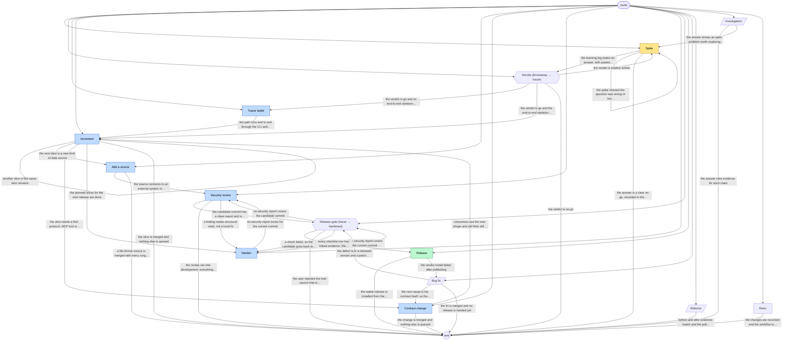

# fusenduck-flow workflow graph

Generated by `vajra/scripts/validate.mjs --write-graph`. Do not edit by hand; edit playbook frontmatter and regenerate.

| Playbook | Kind | Phase | Lifecycle | Exits to |
|---|---|---|---|---|
| [add-source](playbooks/add-source.md) | work | expand | tracer | security-review, end |
| [bug-fix](playbooks/bug-fix.md) | service | any | any | contract-change, release-gate, end |
| [contract-change](playbooks/contract-change.md) | work | expand | tracer | increment, end |
| [decide](playbooks/decide.md) | gate (throwaway → tracer) | explore | any | tracer-bullet, increment, spike, end |
| [harden](playbooks/harden.md) | work | expand | tracer | security-review, release-gate |
| [increment](playbooks/increment.md) | work | expand | tracer | increment, add-source, contract-change, harden, end |
| [investigation](playbooks/investigation.md) | service | any | any | end, spike |
| [refactor](playbooks/refactor.md) | service | any | any | end |
| [release-gate](playbooks/release-gate.md) | gate (tracer → hardened) | extract | any | release, security-review, end, harden |
| [release](playbooks/release.md) | work | extract | hardened | end, bug-fix |
| [retro](playbooks/retro.md) | work | any | any | end |
| [security-review](playbooks/security-review.md) | work | expand | tracer | release-gate, end, harden |
| [spike](playbooks/spike.md) | work | explore | throwaway | decide, spike, end |
| [tracer-bullet](playbooks/tracer-bullet.md) | work | expand | tracer | increment |
